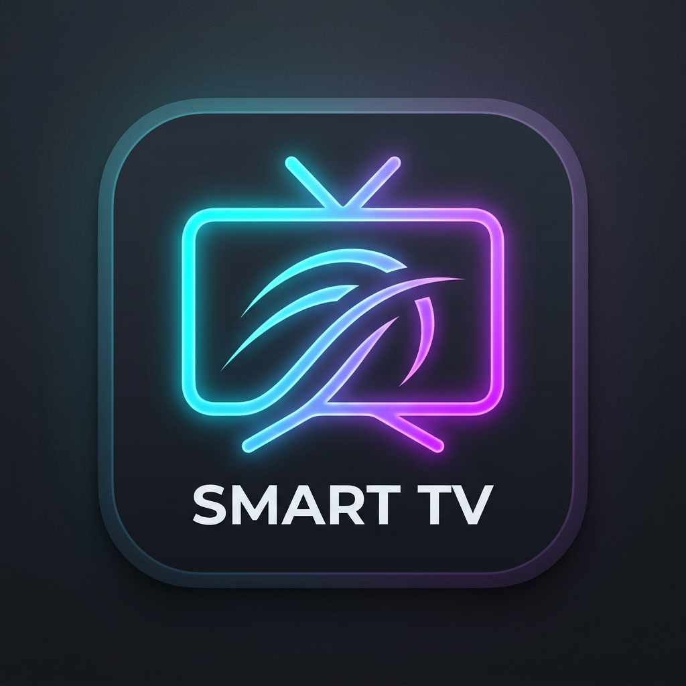

# 📺 Fast TV Launcher - Living Room Cinematic Edition

<p align="center">
  
</p>

<p align="center">
  <b>Um Dashboard / Launcher pessoal cinematográfico, ultraleve e rápido para Smart TVs Samsung (Tizen OS).</b><br>
  Inspirado no visual premium do <i>Apple TV (tvOS 18)</i>, <i>Google TV</i> e <i>Sony PlayStation 5</i>.<br>
  Otimizado para rodar a <b>60 FPS estáveis</b> em hardware de entrada com <b>2GB de memória RAM</b>.
</p>

<p align="center">
  
  
  
  
  
</p>

---

## 📖 Sumário
1. [Visão Geral & Motivação](#-visão-geral--motivação)
2. [Tecnologias Utilizadas](#-tecnologias-utilizadas)
3. [Principais Recursos](#-principais-recursos)
4. [Otimizações Específicas para Smart TVs com 2GB de RAM](#-otimizações-para-smart-tvs-com-2gb-de-ram)
5. [Mapeamento do Controle Remoto Samsung](#-mapeamento-do-controle-remoto-samsung)
6. [Estrutura do Projeto](#-estrutura-do-projeto)
7. [Guia de Instalação e Deploy via SDB / Tizen CLI](#-guia-de-instalação-e-deploy-passo-a-passo)
8. [Configuração de Inicialização Automática (Multitasking)](#-configuração-de-inicialização-automática)
9. [Licença & Créditos](#-licença--créditos)

---

## ⚡ Visão Geral & Motivação

Smart TVs de entrada como a **Samsung UN43T5300AGXZD** (e modelos com Tizen 5.0 / 5.5) sofrem frequentemente com a lentidão do sistema nativo Smart Hub: excesso de propagandas, interface sobrecarregada, abertura demorada de aplicativos e engasgos ao alternar entradas HDMI.

O **Fast TV Launcher** resolve esses problemas substituindo a tela padrão por um launcher independente:
- **Zero Frameworks Pesados**: Sem React, Vue ou Angular. Escrito 100% em Vanilla JavaScript, HTML5 semântico e CSS3 puro.
- **Consumo Mínimo de Recursos**: Menos de 15MB de memória alocada no navegador Tizen.
- **Carregamento Instantâneo**: Inicialização em menos de 250ms a partir do boot da TV.
- **Sem Anúncios**: Apenas o que importa para a sua sala de estar: seus apps de streaming, entradas de vídeo e ferramentas do sistema.

---

## 🛠️ Tecnologias Utilizadas

O projeto foi construído respeitando as restrições de arquitetura de TV de sala de estar (10-Foot UI):

| Tecnologia | Descrição & Aplicação no Projeto |
| :--- | :--- |
| **HTML5 Puro** | Estruturação semântica em 1920x1080 (Full HD), viewport fixa com safe-areas (56px horizontais, 36px verticais) para evitar *overscan*. |
| **Vanilla CSS3 Moderno** | Layout flexível em trilhos horizontais (*Horizontal Rails*), transformações 3D aceleradas por GPU (`scale`, `translateZ`), sistema de variáveis CSS e animações com curvas físicas. |
| **Vanilla JavaScript (ES6+)** | Lógica de inicialização assíncrona, orquestração de modais e gerenciamento de estado persistente via `localStorage`. |
| **Motor de Navegação Espacial 2D** | Algoritmo proprietário de navegação matricial bidirecional para controles remotos D-Pad, com memória de coluna, detecção de bordas e **Focus Trap** estrito em caixas de diálogo. |
| **Web Audio API** | Síntese de áudio procedural de retorno acústico de toque de madeira (*acoustic living room tap*) gerado matematicamente em tempo de execução (**0 KB de arquivos de áudio externos**). |
| **Open-Meteo REST API** | Previsão climática pública em tempo real, sem necessidade de chaves de API pagas, com mecanismo de cache de 30 minutos em `localStorage` para poupar rede e CPU. |
| **Samsung WebAPIs & Tizen TV SDK** | Mapeamento das teclas especiais de hardware da Samsung (`webapis.productinfo`, `tizen.application.launch`, `tizen.tvwindow`, `tv.inputdevice`). |
| **Tizen Core CLI (`tz`) & SDB** | Ferramentas de assinatura digital com certificados X.509 (`.p12`) e envio de pacotes via bridge de depuração da TV (`192.168.0.x:26101`). |

---

## 🌟 Principais Recursos

### 1. Palco de Destaque Dinâmico (*Hero Spotlight*)
Ao navegar com o controle remoto por qualquer aplicativo, entrada HDMI ou ajuste, a área superior de destaque exibe instantaneamente a **etiqueta de categoria**, o **nome oficial** e a **sinopse/descrição** daquele item.

### 2. Iluminação de Fundo com Transição Suave (*Dynamic Mesh Backdrop*)
O fundo da tela realiza um *cross-fade* suave de 0.5s para uma iluminação ambiente difusa inspirada nas cores da marca selecionada (Vermelho suave para YouTube/Netflix, Azul para Prime/Max, Verde para Spotify, Violeta para HDMI).

### 3. Cartões Widescreen 16:9 Híbridos com Reflexo Especular (*Specular Sheen*)
- Cartões dimensionados em formato widescreen 16:9 (`216px x 132px`).
- Fundo temático com vinheta escura degradê (*scrim*) que protege o contraste visual.
- **Feixe de luz deslizante**: Um brilho de luz físico atravessa diagonalmente o cartão ao receber foco.
- **Micro-Badges**: Etiquetas prateadas discretas de especificações (`4K HDR`, `DOLBY VISION`, `MAX`, `IMAX`, `AO VIVO`, `HI-FI`, `GRÁTIS`, `WEB`).

### 4. Barra de Abas Superiores (*Top Navigation Tab Bar*)
Uma barra de abas translúcida no topo da tela (`Início`, `Streaming`, `Entradas`, `Sistema`) que sincroniza dinamicamente enquanto você navega entre as linhas, permitindo pular de seção com a seta para cima.

### 5. Indicador de Sinal Ativo nas Entradas HDMI
Os cartões das conexões **HDMI 1**, **HDMI 2** e **TV Aberta (DTV)** contam com um ponto esmeralda de sinal ativo (*Live Signal Dot*) e exibem a resolução de transmissão (`1080p @ 60Hz`).

### 6. Dock Flutuante de Vidro na Base (*Floating Glass Dock*)
Cápsula elegante de vidro jateado (*frosted glass*) na base da tela exibindo as pílulas coloridas oficiais do controle remoto Samsung:
- 🔴 **Tecla A**: Abertura direta do **YouTube**
- 🟢 **Tecla B**: Abertura direta da **Netflix**
- 🟡 **Tecla C**: Ativação do **Modo de Organizar / Reordenar Apps**
- 🔵 **Tecla D**: Limpeza instantânea de memória RAM e cache

### 7. Modo de Reordenação de Apps com Salvamento Automático
Pressione a tecla amarela (C) do controle ou selecione a ferramenta "Organizar Apps". Use as setas ◀ e ▶ para reposicionar qualquer cartão na linha de favoritos e pressione OK para salvar no `localStorage`.

### 8. Temporizador de Sono (*Sleep Timer*) Integrado
Programe o desligamento automático do televisor em 15, 30, 45 ou 60 minutos, com mostrador do tempo restante no cabeçalho.

### 9. Modo Cinema (Apagar Painel)
Desliga os emissores de luz do painel da TV para ouvir podcasts no Spotify ou descansar a visão sem desligar o aplicativo em execução.

---

## ⚡ Otimizações para Smart TVs com 2GB de RAM

Televisores de entrada contam com processadores ARM modestos e 1.5GB a 2GB de RAM compartilhada entre sistema e vídeo. O Fast TV Launcher implementa as seguintes regras de alto desempenho:

1. **Zero `backdrop-filter: blur(...)`**:
   - O filtro de desfoque em tempo real do CSS aloca texturas intermediárias pesadas no buffer da GPU.
   - Substituído por cores sólidas escuras pré-compostas (`#0e121a` e `#11151f`), economizando entre **30MB e 50MB de VRAM**.
2. **Isolamento de Layout com CSS Containment**:
   - Todos os cartões utilizam `contain: layout style;` e o container de fundo usa `contain: strict;`.
   - O motor WebKit/Blink repinta apenas o elemento que mudou de estado, sem recalcular a árvore DOM inteira.
3. **Eliminação de Repaints Contínuos (`@keyframes`)**:
   - Elementos em repouso não possuem loops infinitos de animação.
   - O ponto verde HDMI é estático com sombra limpa, garantindo 0% de uso de CPU quando o usuário não estiver interagindo.
4. **Cache Inteligente de Mutações de DOM no Relógio**:
   - O `ClockWidget` armazena em cache o minuto e a data formatada, tocando no DOM apenas quando o minuto efetivamente vira (economia de 59 mutações inúteis a cada 60 segundos).
5. **Prevenção de Explosão de Camadas de Composição (*Layer Explosion*)**:
   - `will-change` foi removido de cartões ociosos para evitar que a GPU aloque dezenas de texturas simultâneas na memória.

---

## 🎮 Mapeamento do Controle Remoto Samsung

| Tecla do Controle | Código Tizen | Função no Launcher |
| :---: | :---: | :--- |
| **◀ ▶ ▲ ▼** | `37`, `39`, `38`, `40` | Navegação espacial entre abas, aplicativos, entradas e ferramentas |
| **OK / Enter** | `13` | Abrir aplicativo selecionado ou comutar entrada HDMI |
| **Voltar / Return** | `10009` / `8` | Fecha modais abertos; se em outras linhas, sobe para Apps; se na raiz, abre confirmação de saída |
| **🔴 Tecla A (Vermelha)** | `403` | Atalho rápido para o **YouTube** |
| **🟢 Tecla B (Verde)** | `404` | Atalho rápido para a **Netflix** |
| **🟡 Tecla C (Amarela)** | `405` | Ativa/Desativa o **Modo de Organizar Apps** (◀ / ▶ movem o app focado) |
| **🔵 Tecla D (Azul)** | `406` | Executa a **Otimização de RAM e Descarte de Caches** |
| **Info** | `457` | Exibe o painel de diagnóstico do televisor (Modelo, Resolução, DUID, Tizen OS) |

---

## 📂 Estrutura do Projeto

```text
laucher TV/
│
├── config.xml                  # Manifesto oficial Tizen (permissões, ID, TV profile, multitasking)
├── index.html                  # Estrutura HTML5 Full HD 1080p do Launcher
├── icon.png                    # Ícone de alta fidelidade na tela do Tizen (512x512)
├── profiles.xml                # Perfil de assinatura digital Tizen
├── author.p12                  # Chave privada do autor (certificada via tz CLI)
│
├── css/
│   └── style.css               # Design System Cinemático (Safe-areas, 16:9 widescreen, Dock)
│
├── js/
│   ├── tizen-keys.js           # Registro de chaves de hardware do controle Samsung
│   ├── navigation.js           # Motor de navegação espacial matricial (Focus Trap e áudio)
│   ├── apps.js                 # Catálogo de Apps, Hero Spotlight, Comutação HDMI e Reordenação
│   ├── clock.js                # Relógio em tempo real, saudação humana e data em português
│   ├── weather.js              # Widget de clima com Open-Meteo REST API e cache de 30min
│   └── main.js                 # Inicialização, ouvintes de abas e gerenciador de modais
│
├── scripts/
│   ├── build-wgt.ps1           # Empacota os arquivos do projeto no container FastTVLauncher-raw.wgt
│   ├── sign-and-install.ps1    # Assina digitalmente o pacote e instala na TV via SDB
│   └── build-wgt.bat           # Script complementar para ambiente Windows Batch
│
└── README.md                   # Documentação completa e explicativa da aplicação
```

---

## 🚀 Guia de Instalação e Deploy Passo a Passo

### Pré-requisitos
1. Um computador na mesma rede Wi-Fi ou cabo de rede que a Smart TV Samsung.
2. Smart TV Samsung com **Modo Desenvolvedor** ativado.
3. [Tizen CLI / Tizen Studio](https://developer.samsung.com/smarttv/develop/getting-started/setup-sdk/installing-tv-sdk.html) instalado no computador.

### Passo 1: Ativar o Modo Desenvolvedor na Smart TV
1. No controle remoto da TV, abra o menu **Apps**.
2. Digite a sequência no controle numérico:
   ```text
   1  2  3  4  5
   ```
3. Na janela pop-up oculta **Developer Mode Configuration**, marque a opção **ON**.
4. No campo **Host PC IP**, insira o endereço IPv4 do seu computador (obtenha via terminal com `ipconfig`).
5. Clique em **OK** e reinicie a TV segurando o botão **Power** do controle por 5 segundos até o logo da Samsung reaparecer.

### Passo 2: Descobrir o IP da sua Smart TV
No menu da TV: `Configurações` -> `Geral` -> `Rede` -> `Status da Rede` -> `Configurações de IP`.  
*Exemplo:* `192.168.0.7`.

### Passo 3: Compilar e Instalar via PowerShell
Abra o PowerShell na pasta raiz do projeto e execute os scripts de automação:

```powershell
# 1. Gera o pacote .wgt com os arquivos da aplicação
powershell -ExecutionPolicy Bypass -File "scripts/build-wgt.ps1"

# 2. Assina com o certificado e instala diretamente na TV (porta padrão 26101)
powershell -ExecutionPolicy Bypass -File "scripts/sign-and-install.ps1"
```

O script irá:
1. Conectar à TV via `sdb connect 192.168.0.7:26101`.
2. Assinar o pacote com o perfil `tvprofile`.
3. Fazer o push e instalar o aplicativo na memória flash da TV.
4. Iniciar a execução automaticamente na tela (`was_execute`).

---

## 🔄 Configuração de Inicialização Automática

O arquivo `config.xml` está configurado para garantir que a TV mantenha o Fast TV Launcher ativo sempre que for ligada:

```xml
<!-- Multitasking e Manutenção em Standby -->
<tizen:setting screen-orientation="landscape" 
               context-menu="enable" 
               background-support="enable" 
               encryption="disable" 
               install-location="auto"/>

<tizen:metadata key="http://samsung.com/tv/metadata/multitasking.support" value="true"/>
<tizen:metadata key="http://samsung.com/tv/metadata/prelaunch.support" value="true"/>
```

> **Dica Samsung**: No menu da TV em `Configurações` -> `Geral` -> `Recursos Inteligentes`, habilite a opção **"Autorun Last App" (Executar Último Aplicativo Automaticamente)**. Ao desligar a TV no Fast TV Launcher, ele iniciará imediatamente na próxima vez que a TV for ligada!

---

## 📄 Licença & Créditos

Desenvolvido para transformar qualquer Smart TV Samsung em um centro de entretenimento rápido, elegante e sem distrações.

- **Desenvolvedor:** [NetoNog](https://github.com/NetoNog)
- **Repositório:** [https://github.com/NetoNog/LaucherTVLinux.git](https://github.com/NetoNog/LaucherTVLinux.git)
- **Licença:** MIT (Livre para uso, modificação e distribuição pessoal).
